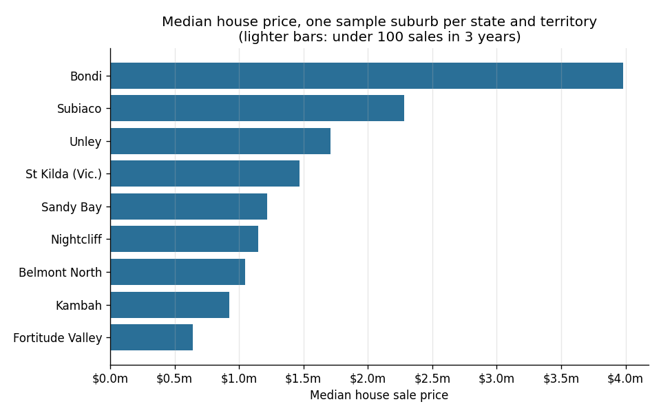

# Python quickstart: your first 10 minutes with the Microburbs API

A short, copyable walk-through in Python. In about 100 lines of code it goes from a key to a table and
a chart covering the nine sandbox suburbs, one per state and territory. It runs on the public sandbox
key, `test`, with no sign-up; [get a key](https://www.microburbs.com.au/developers/keys) for every
suburb and address in Australia.

1. set your key from an environment variable (or use the sandbox key);
2. find a suburb with the suburb geocoder;
3. look up one property: its profile, estimated value and sale history;
4. loop over the suburbs into a pandas DataFrame of market figures (median unit and house
   price, weekly rents, gross yield, 1- and 5-year growth, sales count), politely and with
   missing data handled;
5. chart it;
6. pull 2021 figures from our area statistics.

It comes two ways, with the same steps and the same explanations:

- [`quickstart.ipynb`](quickstart.ipynb): a Jupyter notebook, saved with the output of a
  real run so you can read it here on GitHub without running anything;
- [`quickstart.py`](quickstart.py): a plain script for people who don't use notebooks.



## Run it

You need Python 3.10 or newer. No key needed for the sandbox.

```bash
python -m venv .venv && source .venv/bin/activate   # Windows: .venv\Scripts\activate
pip install -r requirements.txt
cp .env.example .env    # optional: MICROBURBS_API_KEY=test, or your own key
```

Then either:

```bash
python quickstart.py     # prints each step; writes out/sample_suburbs_market.csv and out/house_prices.png
jupyter notebook quickstart.ipynb
```

The script takes a few seconds. `.env` is gitignored, so your key stays out of git. If
you'd rather not use a file, `export MICROBURBS_API_KEY=...` works too.

## The helper client

[`microburbs_client.py`](microburbs_client.py) is a small client (about 100 lines) built on `requests`.
Copy it into your own project.

```python
from microburbs_client import Microburbs, MicroburbsError

mb = Microburbs()  # reads MICROBURBS_API_KEY (default: the sandbox key "test"), and MICROBURBS_API_BASE if set

mb.get("/v1/suburbs/St Kilda (Vic.)/market/median-rent")
# {'area_name': 'St Kilda (Vic.)', 'area_level': 'suburb', 'house': ..., 'unit': ..., 'as_of': ...}

mb.get("/v1/geocode/suburb", q="st kilda")  # query params as kwargs
```

- Write paths as they appear in the docs. Suburb names go in as-is (`St Kilda (Vic.)`); the
  client URL-encodes them.
- `get()` returns the `data` part of the response, or `None` when the API has no figure for
  that place (it answers `{"data": null, "available": false, ...}` rather than an error).
  Always allow for `None`.
- On `429 Too Many Requests` or a brief 5xx error it waits and retries, using `Retry-After`
  when present, otherwise backing off 1, 2, 4… seconds.
- Anything else, such as the sandbox key asking for a suburb outside the sandbox (403), raises
  `MicroburbsError` with the API's own message.

The rate limit is about 10 requests a second per key. The suburb loop runs 4 requests at a
time; keep it under 8.

## Endpoints used

| Step | Endpoint |
|---|---|
| 1 | `GET /v1/ping` |
| 2 | `GET /v1/geocode/suburb?q=...` (with your own key, also `GET /v1/geocode/address?address=...`) |
| 3 | `GET /v1/properties/{gnaf_id}/profile`, `/basics/all`, `/valuation/avm`, `/sale-history` |
| 4 | per suburb `/market/median-sale-price`, `/market/median-rent`, `/market/yield-pct`, `/market/price-growth`, `/sales/summary` |
| 6 | `GET /v1/area-stats/fields?query=...`, `GET /v1/area-stats/SAL/{suburb}/values?fields=...` |

Full reference: https://www.microburbs.com.au/developers/api-docs

## Good to know

- **The sandbox key covers nine suburbs and eight properties**: Bondi, Belmont North, St Kilda (Vic.),
  Fortitude Valley, Subiaco, Unley, Sandy Bay, Kambah and Nightcliff, and the sample GNAF ids in the
  [repo README](../README.md). Anything else, and billed endpoints like address search, return 403.
  [Get a key](https://www.microburbs.com.au/developers/keys) for the whole country.
- **Suburb names are the official suburb names (SAL)**, some with suffixes: `St Kilda (Vic.)`. Use
  `/v1/geocode/suburb` to turn what a user typed into the right name.
- **Small suburbs have noisy medians.** One unusual sale moves a thin market's figures a lot. The
  `sales_3y` column is there so you can tell.
- Yield and growth come back as fractions: `0.045` means 4.5%.

## Files

```
quickstart.ipynb       the notebook, with outputs
quickstart.py          the same steps as a script, in `# %%` cells (VS Code and PyCharm can run it cell by cell)
microburbs_client.py   the helper client
requirements.txt       pinned dependencies
.env.example           copy to .env to set a key
images/chart.png       the chart from step 5
```
